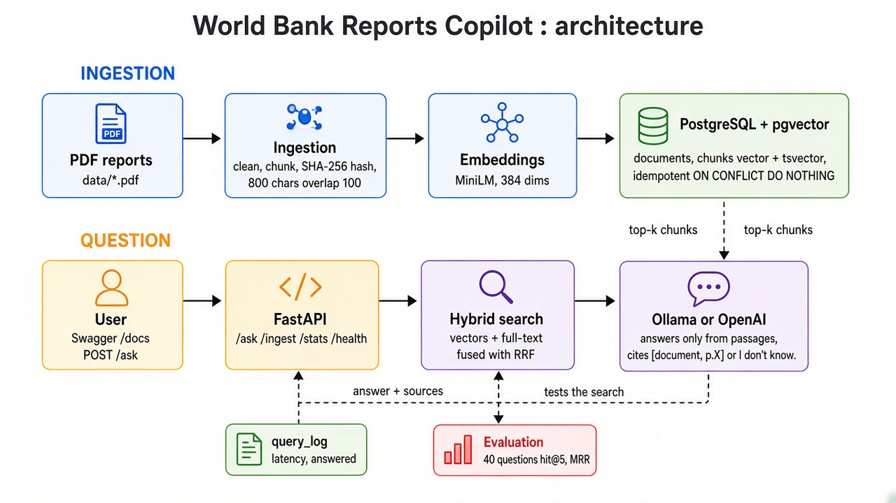

# World Bank Reports Copilot

Ask questions about World Bank reports and get answers with citations (document and page), or an honest "I don't know".

## Architecture



PDFs -> ingestion pipeline (clean, chunk, hash, embed) -> PostgreSQL + pgvector -> hybrid search (vectors + full-text, RRF) -> LLM -> FastAPI

## Key design choices

- **Idempotent ingestion**: each chunk has a content hash; re-running creates no duplicates
- **Hybrid search**: vector similarity and PostgreSQL full-text search, merged with Reciprocal Rank Fusion
- **Grounded answers**: the model answers only from retrieved passages and cites its sources
- **Evaluation**: hit@5 and MRR on 40 hand-written questions
- **Observability**: every query is logged (latency, answered or not), exposed at `/stats`

## Evaluation results

| Chunk size / overlap | hit@5 | MRR |
|---|---|---|
| 500 / 50 | 0.825 | 0.669 |
| 800 / 100 | **0.875** | 0.651 |
| 1200 / 150 | 0.825 | 0.602 |

Chosen config: **800 / 100**. After 10 logged queries (local Ollama `llama3.2`), `/stats` reported **21.7 s** average latency and **40%** answered. Off-topic questions are refused with "I don't know based on the provided documents."

## Run it

```bash
cp .env.example .env
docker compose up --build
```

Put PDFs in `data/`, then open http://localhost:8000/docs and call POST `/ingest`, then POST `/ask`.

### Local development (without Docker API)

```powershell
docker compose up -d db
python -m venv venv
venv\Scripts\activate
pip install -r requirements.txt
copy .env.example .env
python -m src.ingest
uvicorn src.api:app --reload
```

## Limitations

- Scanned PDFs and complex tables are not handled well
- Small evaluation set (40 questions), written by me
- Answer quality depends on the LLM you choose
- Not an official World Bank product

## Tech stack

Python, FastAPI, PostgreSQL, pgvector, sentence-transformers, Docker, pytest, GitHub Actions
